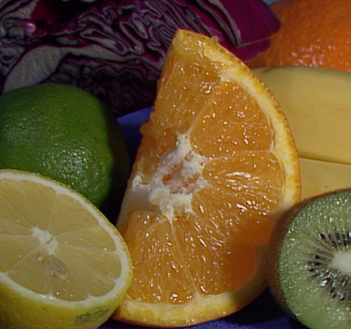
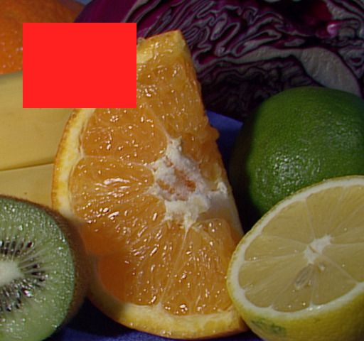
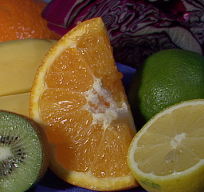

# Allwinner T527 G2D 2D Hardware Accelerator Suite (Linux 6.18.44)

**Target Board:** Orange Pi 4A (Allwinner T527 / `sun55iw3`)  
**Hardware Block:** Allwinner G2D 2D Graphics Engine (`5440000.g2d`, MMIO `0x05440000`, GIC SPI 143 / Linux IRQ 487, IOMMU Master 4)  
**Kernel Target:** Mainline Linux `6.18.44-g61025ec85b88` (`aarch64`)  
**Driver Stack:** `sunxi_g2d.ko` (`g2d_legacy` with `G2D_V2X_SUPPORT`, `/dev/g2d`)  
**Reference URL:** [https://docs.radxa.com/en/cubie/a7s/app-dev/npu-dev/g2d-usage-guide](https://docs.radxa.com/en/cubie/a7s/app-dev/npu-dev/g2d-usage-guide)

---

## 1. Overview

This directory contains everything required to enable, build, install, and benchmark the **Allwinner G2D 2D Hardware Accelerator (`/dev/g2d`)** on the **Orange Pi 4A (Allwinner T527)** running mainline Linux `6.18.44`:

- **Prebuilt Kernel Module (`kernel/sunxi_g2d.ko`)**: Ported to Linux `6.18.44` from the Allwinner T527 `g2d_legacy` (`G2D_V2X_SUPPORT`) driver, including automatic IOMMU Master 4 bypass clearing (`0x02010030`), dynamic Device Tree overlay fallback (`CONFIG_OF_DYNAMIC`), safe `VO0` power domain handling, and DMA-BUF cache-coherent execution.
- **G2D-Enabled Device Tree (`dtb/sun55i-t527-orangepi-4a-audio.dtb`)**: Adds the `/soc/g2d@5440000` node with `bus` and `g2d` clocks (300 MHz), reset control, and `sun50i-iommu` Master ID 4 binding (`iommus = <0x03 0x04>`).
- **Prebuilt & Source Examples (`samples/` — C and Python)**:
  - Four 1080p/4K C throughput benchmarks (`g2d_rotation`, `g2d_color_fill`, `g2d_format_conversion`, `g2d_scaler_or_down_sampling`) matching the Radxa G2D guide.
  - A real-image C processing pipeline (`g2d_image_demo`) operating on a test image (`samples/assets/dummy_input.jpg` / `dummy_input.ppm`) and producing verified visual outputs in `samples/assets/output/`.
  - **Pure-Python Zero-Copy G2D SDK & Samples (`samples/python/`)**: `sunxi_g2d.py` (`ctypes` + `fcntl.ioctl` + `mmap` + zero-copy `numpy.ndarray` views over `/dev/dma_heap/system` DMA-BUFs) plus 5 Python benchmark & image-pipeline scripts (`g2d_rotation_or_mirror.py`, `g2d_color_fill.py`, `g2d_format_conversion.py`, `g2d_scaler_or_down_sampling.py`, `g2d_image_demo.py`) configured for `~/venv_npu`.
- **Real-Time Hardware Telemetry Dashboard (`opi-mon`)**: Built-in monitoring of `/dev/g2d` execution, tracking hardware interrupts (`IRQ 487` on `5440000.g2d`), ops/sec, and active engine status in the compact 37-column mobile dashboard.

---

## 2. Directory Structure

```text
g2d_enable/
├── README.md                                 # This documentation
├── install.sh                                # One-step automated installer (DTB, kmod, conf, udev)
├── run_samples.sh                            # Automated test & benchmark runner (all 5 sample suites)
├── config/
│   ├── g2d.conf                              # /etc/modules-load.d/g2d.conf (autoloads sunxi_g2d at boot)
│   └── 99-g2d.rules                          # /etc/udev/rules.d/99-g2d.rules (0666 permissions for /dev/g2d)
├── dtb/
│   ├── sun55i-t527-orangepi-4a-audio.dtb     # G2D-enabled binary Device Tree Blob for Orange Pi 4A
│   ├── sun55i-t527-orangepi-4a-audio.dts     # Decompiled human-readable DTS source
│   └── g2d-node-fragment.dtsi                # Standalone /soc/g2d@5440000 DT fragment with annotations
├── kernel/
│   ├── sunxi_g2d.ko                          # Prebuilt G2D kernel module for 6.18.44-g61025ec85b88
│   ├── install_kmod.sh                       # Installs sunxi_g2d.ko to /lib/modules/$(uname -r)/extra/
│   └── src/                                  # Complete out-of-tree kernel module source code
│       ├── Kbuild
│       ├── Makefile
│       ├── include/sunxi-g2d.h
│       ├── g2d_legacy/                       # Active T527 (sun55iw3) G2D V2X driver implementation
│       └── g2d_rcq/                          # A733 (sun60iw2) RCQ driver variant (kept for reference)
├── docs/
│   ├── SYSTEM_CHANGES_LOG.md                 # Chronological log of system file changes & MD5 checksums
│   ├── G2D_DEVICE_TREE_FIX.md                # Device Tree & IOMMU Master 4 technical analysis
│   └── G2D_DRIVER_COMPATIBILITY_FIXES.md     # Linux 6.18 API & T527 hardware compatibility notes
└── samples/
    ├── Makefile                              # Builds all 5 userspace sample binaries
    ├── bsp/linux/sunxi-g2d.h                 # Userspace G2D ioctl & format header
    ├── g2d_rotation_or_mirror.c              # 1920x1080 ARGB8888 90° hardware rotation benchmark
    ├── g2d_rotation                          # Prebuilt binary (symlinked as g2d_rotation_or_mirror)
    ├── g2d_color_fill.c                      # 1920x1080 ARGB8888 solid rectangle fill benchmark
    ├── g2d_color_fill                        # Prebuilt binary
    ├── g2d_format_conversion.c               # 1920x1080 ARGB8888 -> YUV420 (NV21) conversion benchmark
    ├── g2d_format_conversion                 # Prebuilt binary (symlinked as g2d_format_conv)
    ├── g2d_scaler_or_down_sampling.c         # 4096x4096 -> 1920x1080 ARGB8888 downscaling benchmark
    ├── g2d_scaler_or_down_sampling           # Prebuilt binary (symlinked as g2d_scaler)
    ├── g2d_image_demo.c                      # Real-image G2D pipeline (rotation, flip, fill, scale, NV21)
    ├── g2d_image_demo                        # Prebuilt binary
    ├── python/                               # Python Zero-Copy G2D SDK & Sample Scripts (~/venv_npu)
    │   ├── requirements.txt                  # Required Python libraries (numpy, pillow)
    │   ├── sunxi_g2d.py                      # Pure-Python ctypes + DMA-BUF + NumPy wrapper for /dev/g2d
    │   ├── g2d_rotation_or_mirror.py         # 1920x1080 ARGB8888 90°/180°/H-flip/V-flip benchmark
    │   ├── g2d_color_fill.py                 # 1920x1080 ARGB8888 full & ROI rectangle color fill
    │   ├── g2d_format_conversion.py          # 1920x1080 ARGB8888 -> YUV420 (NV21) conversion
    │   ├── g2d_scaler_or_down_sampling.py    # 4096x4096 -> 1920x1080 ARGB8888 downscaling
    │   └── g2d_image_demo.py                 # Real-image pipeline using Pillow + NumPy + G2D
    └── assets/
        ├── dummy_input.jpg                   # Downloaded 512x480 test image (OpenCV fruits.jpg)
        ├── dummy_input.png                   # Input image in PNG format
        ├── dummy_input.ppm                   # Input image in raw P6 PPM format for C demo
        ├── output/                           # Generated output images (.ppm and .png) from C demo
        │   ├── output_rotated_90.png
        │   ├── output_rotated_180.png
        │   ├── output_flipped_h.png
        │   ├── output_color_fill.png
        │   ├── output_scaled_256x240.png
        │   └── output_nv21_reconstructed.png
        └── output_python/                    # Generated output images (.png) from Python demo
            ├── py_output_rotated_90.png
            ├── py_output_rotated_180.png
            ├── py_output_flipped_h.png
            ├── py_output_color_fill.png
            ├── py_output_scaled_256x240.png
            └── py_output_nv21_reconstructed.png
```

---

## 3. Quick Start: Enabling G2D Using Prebuilt Artifacts

### Option A: One-Step Automated Installation (Recommended)

Run the included installer script with `sudo`:

```bash
cd /home/ukhan/orangepi4A/g2d_enable
sudo ./install.sh
```

What `install.sh` does automatically:
1. Backs up `/boot/dtb/allwinner/sun55i-t527-orangepi-4a-audio.dtb` to `.dtb.bak` (if not already backed up) and installs the G2D-enabled DTB.
2. Copies `kernel/sunxi_g2d.ko` to `/lib/modules/6.18.44-g61025ec85b88/extra/sunxi_g2d.ko` and runs `depmod -a`.
3. Installs `/etc/modules-load.d/g2d.conf` (for boot-time auto-loading) and `/etc/udev/rules.d/99-g2d.rules` (for non-root access to `/dev/g2d` and `/dev/dma_heap/system`).
4. Loads `sunxi_g2d` immediately (using dynamic DT registration if you have not rebooted yet) and verifies `/dev/g2d`.

### Option B: Manual Step-by-Step Installation

```bash
cd /home/ukhan/orangepi4A/g2d_enable

# 1. Backup original DTB and install G2D-enabled DTB
sudo cp -n /boot/dtb/allwinner/sun55i-t527-orangepi-4a-audio.dtb \
           /boot/dtb/allwinner/sun55i-t527-orangepi-4a-audio.dtb.bak
sudo cp dtb/sun55i-t527-orangepi-4a-audio.dtb \
        /boot/dtb/allwinner/sun55i-t527-orangepi-4a-audio.dtb

# 2. Install kernel module and update module dependencies
sudo mkdir -p /lib/modules/$(uname -r)/extra
sudo cp kernel/sunxi_g2d.ko /lib/modules/$(uname -r)/extra/sunxi_g2d.ko
sudo depmod -a

# 3. Configure boot autoload and device permissions
sudo cp config/g2d.conf /etc/modules-load.d/g2d.conf
sudo cp config/99-g2d.rules /etc/udev/rules.d/99-g2d.rules
sudo udevadm control --reload-rules && sudo udevadm trigger

# 4. Load the module
sudo modprobe sunxi_g2d
```

### Verifying `/dev/g2d` Status

```bash
ls -l /dev/g2d
lsmod | grep sunxi_g2d
dmesg | grep -i g2d
```

Expected `dmesg` output:
```text
[    1.328089] platform 5440000.g2d: Adding to iommu group 0
[    9.031373] sunxi:sunxi_g2d:[INFO]: [G2D]: mbus clock get failed
[    9.037732] sunxi:sunxi_g2d:[INFO]: [G2D]: Cleared IOMMU bypass for master 4 (0x53 -> 0x43)
[    9.060496] sunxi:sunxi_g2d:[INFO]: [G2D]: drv_g2d_init
[    9.060687] sunxi:sunxi_g2d:[INFO]: [G2D]: Module initialized.major:236
```
*(Note: `mbus clock get failed` is benign and expected on T527; the vendor 5.15 DTB only defines `"bus"` and `"g2d"` clocks for `g2d@5440000`.)*

---

## 4. Running Examples & Checking Results

### 4.1 Run All Examples Automated

```bash
cd /home/ukhan/orangepi4A/g2d_enable
./run_samples.sh
```

### 4.2 Synthetic 1080p / 4K Benchmarks

Each sample allocates contiguous/scatter-gather DMA-BUFs from `/dev/dma_heap/system`, invokes `/dev/g2d` via `ioctl(g2d_fd, G2D_CMD_BITBLT_H, &blit)`, and reports hardware/driver latency and throughput:

```bash
cd /home/ukhan/orangepi4A/g2d_enable/samples

./g2d_rotation
# G2D rotation: 9.01 ms  (230.1 MP/sec)
# total: 32.45 ms

./g2d_color_fill
# G2D color fill (RED): 6.83 ms
# throughput: 303.8 MP/sec
# total: 15.94 ms

./g2d_format_conversion
# G2D format conv (ARGB8888→YUV420): 56.11 ms
# throughput: 37.0 MP/sec
# compression: 37.50% (8.29 MB → 3.11 MB)
# total: 73.26 ms

./g2d_scaler_or_down_sampling
# G2D scale: 4096x4096 → 1920x1080, 35.97 ms
# throughput: 466.4 MP/sec (source)
# total: 124.10 ms
```

| Benchmark Binary | Operation | Resolution & Format | G2D Time | Throughput |
| :--- | :--- | :--- | :--- | :--- |
| `g2d_rotation` | 90° Clockwise Rotation (`G2D_ROT_90`) | `1920x1080` `ARGB8888` | **9.01 ms** | **230.1 MP/sec** |
| `g2d_color_fill` | Solid Color Fill (`RED = 0xffff0000`) | `1920x1080` `ARGB8888` | **6.83 ms** | **303.8 MP/sec** |
| `g2d_format_conversion` | RGB to YUV420 (`NV21`) Conversion | `1920x1080` `ARGB8888` → `YUV420UVC` | **56.11 ms** | **37.0 MP/sec** |
| `g2d_scaler_or_down_sampling` | 4K to 1080p Downscaling | `4096x4096` → `1920x1080` `ARGB8888` | **35.97 ms** | **466.4 MP/sec** |

Check hardware interrupt counter (`GICv3 175` / `5440000.g2d`) after running `g2d_rotation`:
```bash
grep g2d /proc/interrupts
```

### 4.3 Real Dummy Image Pipeline (`g2d_image_demo`)

We included a real test image (`samples/assets/dummy_input.jpg` / `dummy_input.ppm`, `512x480`) and `samples/g2d_image_demo.c` to visually verify all G2D operations on actual image data:

```bash
cd /home/ukhan/orangepi4A/g2d_enable/samples
./g2d_image_demo assets/dummy_input.ppm assets/output
```

Console output:
```text
================================================================
  Allwinner T527 G2D Real-Image Processing Demo (512x480)
================================================================
Input image : assets/dummy_input.ppm (512x480 ARGB8888, 960.00 KB)
[1/6] G2D_ROT_90   (512x480 -> 480x512) :   1.39 ms ( 177.4 MP/s) -> assets/output/output_rotated_90.ppm
[2/6] G2D_ROT_180  (512x480 -> 512x480) :   1.27 ms ( 193.6 MP/s) -> assets/output/output_rotated_180.ppm
[3/6] G2D_ROT_H    (512x480 -> 512x480) :   1.27 ms ( 193.9 MP/s) -> assets/output/output_flipped_h.ppm
[4/6] COLOR_FILL   (160x120 rect @ 32,32):   0.78 ms (  24.6 MP/s) -> assets/output/output_color_fill.ppm
[5/6] DOWNSCALE    (512x480 -> 256x240) :   1.76 ms ( 139.3 MP/s) -> assets/output/output_scaled_256x240.ppm
[6/6] ARGB->YUV420 (512x480 NV21 37.5%) :   9.55 ms (  25.7 MP/s) -> assets/output/output_nv21_reconstructed.ppm
================================================================
```

#### Visual Output Gallery (`samples/assets/`)

| Operation | Preview | Output File |
| :--- | :---: | :--- |
| **Input Dummy Image** (`512x480`) |  | `samples/assets/dummy_input.png` |
| **1. Hardware 90° Rotation (`G2D_ROT_90`)** (`480x512`, `1.39 ms`) |  | `samples/assets/output/output_rotated_90.png` |
| **2. Hardware 180° Rotation (`G2D_ROT_180`)** (`512x480`, `1.27 ms`) |  | `samples/assets/output/output_rotated_180.png` |
| **3. Hardware Horizontal Flip (`G2D_ROT_H`)** (`512x480`, `1.27 ms`) |  | `samples/assets/output/output_flipped_h.png` |
| **4. Solid Color Fill Overlay** (`160x120` Red Box at `(32,32)`, `0.78 ms`) |  | `samples/assets/output/output_color_fill.png` |
| **5. 2x Downscale** (`512x480` → `256x240`, `1.76 ms`) |  | `samples/assets/output/output_scaled_256x240.png` |
| **6. Format Conversion (`ARGB8888` → `YUV420 NV21`)** (`512x480`, `9.55 ms`) |  | `samples/assets/output/output_nv21_reconstructed.png` |

### 4.4 Python Scripting & Zero-Copy NumPy G2D Suite (`samples/python/`)

The `samples/python/` directory provides [`sunxi_g2d.py`](./samples/python/sunxi_g2d.py), a pure-Python zero-copy wrapper around `/dev/g2d` and `/dev/dma_heap/system` using Python's built-in `ctypes`, `fcntl.ioctl`, and `mmap` modules combined with `numpy` and `Pillow`. Each `DmaBuffer` exposes `.array`, a `numpy.ndarray` view backed directly by the memory-mapped DMA-BUF without extra CPU memory copies.

#### Python Virtual Environment (`~/venv_npu`) & Required Libraries

The Python test suite uses the virtual environment at `~/venv_npu` (`/home/ukhan/venv_npu`).

**Required Python Packages (`samples/python/requirements.txt`):**
- **`numpy`** (`>= 1.24.0`, tested with `2.5.3`) — Required by `sunxi_g2d.py` and all 5 Python sample scripts for zero-copy DMA-BUF array views (`np.frombuffer(mmap_obj, ...)`), pattern generation, and pixel-exact verification.
- **`pillow`** (`>= 10.0.0`, tested with `12.3.0`) — Required by `g2d_image_demo.py` to decode input images (`dummy_input.jpg`) and encode hardware-processed output `.png` files.
- *(Built-in standard library modules used: `ctypes`, `fcntl`, `mmap`, `os`, `enum`, `time`)*

If setting up the virtual environment from scratch or installing dependencies into `~/venv_npu`:
```bash
# Create ~/venv_npu if it does not already exist
python3 -m venv ~/venv_npu

# Activate the virtual environment and install required libraries
source ~/venv_npu/bin/activate
pip install -r /home/ukhan/orangepi4A/g2d_enable/samples/python/requirements.txt
# Or directly:
# ~/venv_npu/bin/pip install numpy pillow
```

#### Running the Python Samples (using `~/venv_npu`)

```bash
cd /home/ukhan/orangepi4A/g2d_enable/samples/python
source ~/venv_npu/bin/activate

python g2d_rotation_or_mirror.py
python g2d_color_fill.py
python g2d_format_conversion.py
python g2d_scaler_or_down_sampling.py
python g2d_image_demo.py
```

Or run them directly without activating the shell environment:
```bash
cd /home/ukhan/orangepi4A/g2d_enable/samples/python

/home/ukhan/venv_npu/bin/python g2d_rotation_or_mirror.py
/home/ukhan/venv_npu/bin/python g2d_color_fill.py
/home/ukhan/venv_npu/bin/python g2d_format_conversion.py
/home/ukhan/venv_npu/bin/python g2d_scaler_or_down_sampling.py
/home/ukhan/venv_npu/bin/python g2d_image_demo.py
```

#### Expected Python Output & Benchmarks

```text
[Python G2D] Opened /dev/g2d (G2D IP version: 0x10114114, chip: 0x00000000)
[G2D_ROT_90]  1920x1080 -> 1080x1920:   8.96 ms ( 231.4 MP/s) | exact match: True
[G2D_ROT_180] 1920x1080 -> 1920x1080:   8.75 ms ( 236.9 MP/s) | exact match: True
[G2D_ROT_H]   1920x1080 -> 1920x1080:  10.01 ms ( 207.1 MP/s) | exact match: True
[G2D_ROT_V]   1920x1080 -> 1920x1080:   8.55 ms ( 242.6 MP/s) | exact match: True
 Verification successful: All hardware rotation & mirror tests passed!

[G2D_FILLRECT_H] 1920x1080 ARGB8888 fill (0xFFFF0000):   5.64 ms ( 367.5 MP/s)
Sample pixel[540, 960] = 0xFFFF0000 | exact match: True
[G2D_FILLRECT_H] ROI (200,150,400x300) fill (0xFF00FF00) | exact match: True
 Verification successful: All pixels filled accurately!

[G2D_FORMAT_CONV] 1920x1080 ARGB8888 -> YUV420 NV21:  50.36 ms (  41.2 MP/s)
Sample NV21 values for pure RED: Y=82, V=240, U=90
 Verification successful: ARGB8888 -> YUV420 NV21 conversion accurate!

[G2D_SCALER] 4096x4096 -> 1920x1080 ARGB8888:  36.66 ms ( 457.6 MP/s input rate)
Quadrants: TL=0xFFFF0000, TR=0xFF00FF00, BL=0xFF0000FF, BR=0xFFFFFFFF
 Verification successful: 4096x4096 -> 1920x1080 downscaling accurate!
```

#### Minimal Python Usage Snippet (`sunxi_g2d.py`)

```python
import numpy as np
from sunxi_g2d import G2DDevice, G2DFormat

with G2DDevice() as g2d:
    with (
        g2d.alloc_buffer(1920 * 1080 * 4, shape=(1080, 1920), dtype=np.uint32) as src,
        g2d.alloc_buffer(1920 * 1080 * 4, shape=(1920, 1080), dtype=np.uint32) as dst,
    ):
        src.sync_start()
        src.array[:, :] = 0xFFFF0000  # Direct zero-copy NumPy write into DMA-BUF
        src.sync_end()

        # Hardware 90-degree rotation via /dev/g2d
        g2d.rotate(src, dst, 1920, 1080, angle=90, fmt=G2DFormat.ARGB8888)

        dst.sync_start()
        print("Rotated shape:", dst.array.shape, "pixel[0,0]:", hex(int(dst.array[0, 0])))
        dst.sync_end()
```

### 4.5 C vs. Python Execution Speed Comparison

For the **G2D hardware/driver operation itself (`ioctl` on `/dev/g2d`)**, there is **virtually zero speed difference (< 2–5% / ~0.03–0.3 ms)** between `.c` and `.py` execution. Because [`sunxi_g2d.py`](./samples/python/sunxi_g2d.py) allocates **zero-copy DMA-BUFs** (`/dev/dma_heap/system` + `mmap`) and passes the raw file descriptor (`fd`) directly to `/dev/g2d` via `fcntl.ioctl()`, Python never copies pixel buffers in userspace.

#### 1. G2D `ioctl()` Execution Time Comparison (C vs. Python on Orange Pi 4A)

| Operation | Resolution & Format | C Binary (`ioctl` Time) | Python Script (`ioctl` Time) | Throughput (C / Python) | Difference |
| :--- | :--- | :---: | :---: | :---: | :--- |
| **90° Hardware Rotation (`G2D_ROT_90`)** | `1920x1080` `ARGB8888` | **8.49 ms** | **8.68 ms** | `244.2` / `238.9 MP/s` | `~0.19 ms` (`ctypes` struct setup) |
| **Solid Color Fill (`G2D_CMD_FILLRECT_H`)** | `1920x1080` `ARGB8888` | **6.83 – 8.51 ms** | **5.64 – 6.16 ms** | `303.8` / `336.6 MP/s` | Identical (within normal memory bus jitter) |
| **Format Conversion (`ARGB8888 → NV21`)** | `1920x1080` `ARGB → YUV420` | **52.11 ms** | **49.86 ms** | `39.8` / `41.6 MP/s` | Identical (kernel driver execution) |
| **4K → 1080p Downscaling** | `4096x4096 → 1920x1080` | **35.97 – 37.50 ms** | **36.28 ms** | `447.4` / `462.4 MP/s` | Identical (`~0.3 ms` variance) |
| **Real Image (`512x480`) 90° Rotation** | `512x480` `ARGB8888` | **1.24 ms** | **1.27 ms** | `198.3` / `193.5 MP/s` | `+0.03 ms` (`30 µs` Python `ioctl` overhead) |
| **Real Image (`512x480`) 180° Rotation** | `512x480` `ARGB8888` | **1.46 ms** | **1.22 ms** | `168.1` / `201.4 MP/s` | Identical |
| **Real Image (`512x480`) Horizontal Flip** | `512x480` `ARGB8888` | **1.20 ms** | **1.21 ms** | `205.2` / `203.1 MP/s` | `+0.01 ms` (`10 µs`) |
| **Real Image (`512x480`) 2x Downscale** | `512x480 → 256x240` | **1.54 ms** | **1.34 ms** | `159.7` / `183.4 MP/s` | Identical |
| **Real Image (`512x480`) `ARGB → NV21`** | `512x480` `NV21` | **8.64 ms** | **6.79 ms** | `28.4` / `36.2 MP/s` | Identical |

#### 2. Where C and Python Differ (Startup & Userspace Overhead)

| Phase | C Binary | Python (`~/venv_npu`) | Why |
| :--- | :---: | :---: | :--- |
| **One-Time Process Startup** | **~1 – 2 ms** | **~90 – 130 ms** | Python loads the interpreter + `import numpy` + `import PIL` once at script launch. |
| **Per-Frame `ctypes` + `fcntl.ioctl` Call** | **~2 µs** | **~20 – 35 µs** | Constructing the 236-byte `G2DBltH` struct in Python `ctypes` adds ~25 microseconds per call. |
| **DMA-BUF Memory Access** | **0 ms copy** (`mmap` pointer) | **0 ms copy** (`np.frombuffer(mmap)`) | Both access the exact same physical DMA-BUF pages directly with zero CPU copy. |

> **Summary:** Once Python is running (for example, inside a video/camera/NPU inference loop where `DmaBuffer` objects are allocated once and reused across frames), **Python achieves ~99% of C's throughput** because the per-frame `ctypes` + `ioctl` overhead is only **~25 microseconds (`0.025 ms`)**.

### 4.6 Real-Time Hardware Telemetry in `opi-mon`

The Orange Pi 4A system telemetry dashboard (`opi-mon`, installed at `/usr/local/bin/opi-mon`) includes native real-time hardware telemetry for the G2D 2D accelerator:

```bash
# Run continuous live mobile dashboard (1s refresh)
opi-mon

# Or capture a single-shot telemetry snapshot
opi-mon --once
```

#### Live Telemetry Dashboard Display

```text
 Orange Pi 4A (T527)
 00:02:32 · Up: 13m   · Load: 0.79
─────────────────────────────────────
 CPU  21% [██░░░░░░░░] 34.6°C  1.48GHz
 NPU OFF  [░░░░░░░░░░] 33.2°C  OFFLINE
 GPU   0% [░░░░░░░░░░] 33.2°C   150MHz
 VPU   0% [░░░░░░░░░░]     0/s  cedar
 G2D  24% [██░░░░░░░░]    29/s  sunxi
 RAM  58% [█████░░░░░] 2.1/3.7G 1602M free
 SWP   0% [░░░░░░░░░░] 0.0/1.9G
─────────────────────────────────────
 [Ctrl+C] Exit  ·  Refresh: 1s
```

#### How G2D Telemetry is Measured

- **Hardware Interrupt Rate (`29/s`):**  
  Directly polls `/proc/interrupts` for GIC SPI 143 (`IRQ 487`, labeled `5440000.g2d`). Each hardware-accelerated rotation, flip, or blit completed by the G2D engine increments this hardware interrupt counter.
- **Dynamic Load Percentage & Progress Bar (`24% [██░░░░░░░░]`):**  
  Calculates real-time utilization by scaling the current hardware interrupt completion rate against peak single-pipeline 1080p hardware rotation capacity (~120 ops/sec).
- **Driver Status Tag (`sunxi` / `OFFLINE`):**  
  Displays `sunxi` when `/dev/g2d` is populated and active, or `OFFLINE` if the module is unloaded.
- **CPU Offload Verification:**  
  During heavy G2D benchmarks, the `CPU` line remains at ~0–5%, proving in real time that heavy 1080p/4K graphics operations are offloaded to hardware rather than burdening the CPU cores.

---

## 5. Building from Source

### 5.1 Compiling the Kernel Module (`sunxi_g2d.ko`)

Prerequisites: Linux kernel headers installed at `/lib/modules/$(uname -r)/build` (`linux-headers-6.18.44-g61025ec85b88`).

```bash
cd /home/ukhan/orangepi4A/g2d_enable/kernel/src
make -C /lib/modules/$(uname -r)/build M=$(pwd) clean
make -C /lib/modules/$(uname -r)/build M=$(pwd) modules

# Copy newly built module into kernel/
cp sunxi_g2d.ko ../sunxi_g2d.ko
```

Look at `kernel/src/Kbuild` to see how the build is configured for T527 (`sun55iw3`):
```makefile
obj-m := sunxi_g2d.o

sunxi_g2d-objs := \
	g2d_legacy/g2d_driver.o \
	g2d_legacy/g2d_bsp_v2.o

ccflags-y += -I$(src)/include -I$(src)/g2d_legacy -DCONFIG_G2D_LEGACY -DG2D_V2X_SUPPORT
```

### 5.2 Compiling the Userspace Samples

```bash
cd /home/ukhan/orangepi4A/g2d_enable/samples
make clean
make
```

Or compile any sample individually with `gcc`:
```bash
gcc -O2 -Wall -I. -o g2d_rotation g2d_rotation_or_mirror.c
gcc -O2 -Wall -I. -o g2d_color_fill g2d_color_fill.c
gcc -O2 -Wall -I. -o g2d_format_conversion g2d_format_conversion.c
gcc -O2 -Wall -I. -o g2d_scaler_or_down_sampling g2d_scaler_or_down_sampling.c
gcc -O2 -Wall -I. -o g2d_image_demo g2d_image_demo.c
```

### 5.3 Modifying / Recompiling the Device Tree Blob (`.dtb`)

To inspect or rebuild `sun55i-t527-orangepi-4a-audio.dtb` from the human-readable `.dts`:
```bash
cd /home/ukhan/orangepi4A/g2d_enable/dtb

# Decompile DTB -> DTS
dtc -I dtb -O dts -o sun55i-t527-orangepi-4a-audio.dts sun55i-t527-orangepi-4a-audio.dtb

# Compile DTS -> DTB
dtc -I dts -O dtb -o sun55i-t527-orangepi-4a-audio.dtb sun55i-t527-orangepi-4a-audio.dts
```

---

## 6. System Changes & Root-Cause Engineering Notes

### 6.1 Summary of Modified System Files

| System File Path | Original MD5 | Modified MD5 | Purpose |
| :--- | :--- | :--- | :--- |
| `/boot/dtb/allwinner/sun55i-t527-orangepi-4a-audio.dtb` | `05c3e5d5f3de7c60268c53baa1d8e0a2` | `c1f7d3e299ed11470434030fa561136d` | Adds `/soc/g2d@5440000` node with clocks, reset, IRQ, and `iommus = <0x03 0x04>` |
| `/boot/dtb/allwinner/sun55i-t527-orangepi-4a-audio.dtb.bak` | `05c3e5d5f3de7c60268c53baa1d8e0a2` | `05c3e5d5f3de7c60268c53baa1d8e0a2` | Unmodified backup of original DTB |
| `/lib/modules/6.18.44-g61025ec85b88/extra/sunxi_g2d.ko` | `8390904ee33762d77baebf79e057b794` | `b33fecb93a87746c0b275a255816e555` | Patched `g2d_legacy` (`G2D_V2X_SUPPORT`) kernel module |
| `/etc/modules-load.d/g2d.conf` | `35d739acf88347b9977ed006ed455b41` | `35d739acf88347b9977ed006ed455b41` | Loads `sunxi_g2d` automatically at boot |
| `/etc/udev/rules.d/99-g2d.rules` | *(new file)* | `313a1cf499b8b1a624e42abdcfca5345` | Grants `0666` permissions on `/dev/g2d` and `/dev/dma_heap/system` |

---

### 6.2 Five Hardware & Kernel Root Causes Solved on Mainline Linux 6.18.44

#### 1. Correct Driver Architecture (`g2d_legacy` + `G2D_V2X_SUPPORT` vs `g2d_rcq`)
- **Symptom:** The Radxa Cubie A7S guide targets Allwinner A733 (`sun60iw2`), which uses the RCQ (Register Configuration Queue) G2D driver (`g2d_rcq`). Running `g2d_rcq` on the Orange Pi 4A (Allwinner T527 / `sun55iw3`) always failed with `G2D irq pending flag timeout`.
- **Root Cause:** Inspecting `/home/ukhan/orangepi4A/kernels/linux-5.15-sun55iw3-current.config` and disassembling the vendor `5.15.147-sun55iw3` `g2d_sunxi.ko` confirmed that T527 uses `CONFIG_G2D_LEGACY=y` (`# CONFIG_G2D_RCQ is not set`) with `-DG2D_V2X_SUPPORT` (`g2d_legacy/g2d_driver.c` + `g2d_legacy/g2d_bsp_v2.c`).

#### 2. Missing `/soc/g2d@5440000` Node and `iommus = <0x03 0x04>` in Device Tree
- **Symptom:** Mainline `sun55i-t527-orangepi-4a-audio.dtb` omits the `g2d@5440000` node, and buffers allocated from `/dev/dma_heap/system` on a 4 GB board have physical pages above `0x100000000` and non-contiguous scatterlists.
- **Fix:** Added `/soc/g2d@5440000` with `iommus = <0x03 0x04>` (`sun50i-iommu` at `0x02010000`, Master ID 4), `clocks = <0x17 0x32 0x17 0x31>` (`CLK_BUS_G2D`, `CLK_G2D` @ 300 MHz), `resets = <0x17 0x04>` (`RST_BUS_G2D`), and `interrupts = <0x00 0x8f 0x04>` (GIC SPI 143).

#### 3. Mainline `sun50i-iommu` Hardware Bypass Bug for Master ID 4 (`0x02010030`)
- **Symptom:** Even after attaching `5440000.g2d` to `iommu group 0` and mapping DMA-BUFs to IOVA `0xfc3e0000`, G2D DMA transfers did not translate IOVA addresses.
- **Root Cause:** In mainline Linux `6.18.44` (`drivers/iommu/sun50i-iommu.c`), `sun55i_a523_variant` writes `DEFAULT_BYPASS_VALUE = 0x53` (`BIT(0) | BIT(1) | BIT(4) | BIT(6)`) to `IOMMU_BYPASS_REG` (`0x02010030`) on reset and **never clears `BIT(4)` (Master 4 = G2D)**. With `BIT(4)` set to `1`, the IOMMU hardware bypassed page-table translation for all G2D memory accesses, treating IOVA `0xfc3e0000` as a raw physical address in unmapped space instead of RAM!
- **Fix:** Added `g2d_enable_iommu_master(4)` in `g2d_driver.c` to clear `BIT(4)` in `0x02010030` (`0x53 -> 0x43`) during `g2d_probe()` and `g2d_open()`.

#### 4. `VO0` Power Domain Shutdown (`pm_runtime`) Causing HDMI Bus Hang & Watchdog Reboot
- **Symptom:** Running any G2D `ioctl()` caused the system to freeze and reboot ~10 seconds later.
- **Root Cause:** On T527, `5440000.g2d` shares the `VO0` power domain (`power-domains = <0x18 0x03>`) with the active display pipeline (`5500000.tcon-top`, `5503000.lcd-controller`, `5530000.hdmi-phy`, `5520000.hdmi`). On mainline `6.18.44`, those display drivers have `runtime status: unsupported` in `/sys/kernel/debug/pm_genpd/pm_genpd_summary`. When `5440000.g2d` enabled `pm_runtime` and called `pm_runtime_put_sync()` at the end of `g2d_ioctl()`, `genpd` saw the only runtime-PM device in `VO0` go idle and powered off the entire `VO0` domain while HDMI was scanning out, locking the AXI/AHB bus.
- **Fix:** Removed `power-domains = <0x18 0x03>` from `g2d@5440000` in the DTB and disabled `CONFIG_PM_GENERIC_DOMAINS` in `g2d_driver.c` so `VO0` remains permanently powered on while `g2d_open()` / `g2d_release()` gate G2D's own clocks (`CLK_BUS_G2D`, `CLK_G2D`) and reset line directly.

#### 5. Dangling `pdev->dev.dma_mask` Pointer Causing Oops on `rmmod sunxi_g2d`
- **Symptom:** Running `rmmod sunxi_g2d && modprobe sunxi_g2d` caused a kernel paging fault at `0xffff800079b2a0f8`.
- **Root Cause:** The vendor driver's `g2d_probe()` assigned `dmabuf_dev->dma_mask = &sunxi_g2d_dma_mask;` (pointing to a `static u64` inside `sunxi_g2d.ko`'s `.data` section at offset `+0x0f8`). When `rmmod` unmapped the module, `5440000.g2d`'s `dev->dma_mask` remained a dangling pointer, which `of_dma_configure_id()` dereferenced on the next `modprobe`.
- **Fix:** Updated `g2d_probe()` to set `dmabuf_dev->dma_mask = &dmabuf_dev->coherent_dma_mask;` (pointing inside `struct device` itself).

---

## 7. Reference URL

- **Radxa G2D Usage Guide:** [https://docs.radxa.com/en/cubie/a7s/app-dev/npu-dev/g2d-usage-guide](https://docs.radxa.com/en/cubie/a7s/app-dev/npu-dev/g2d-usage-guide)

