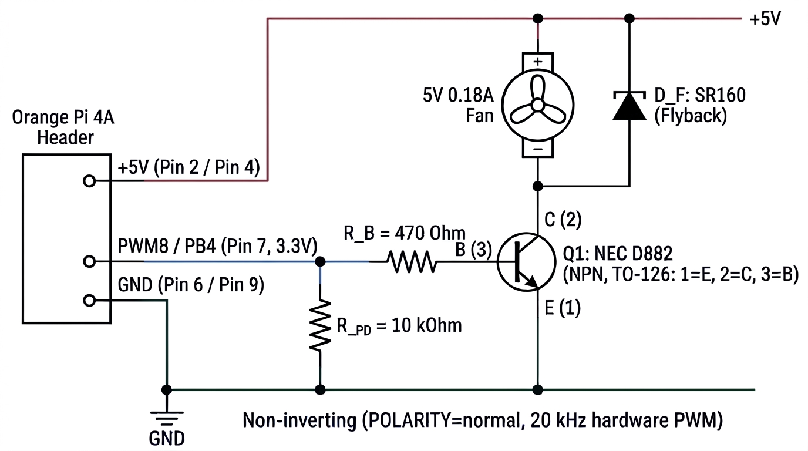
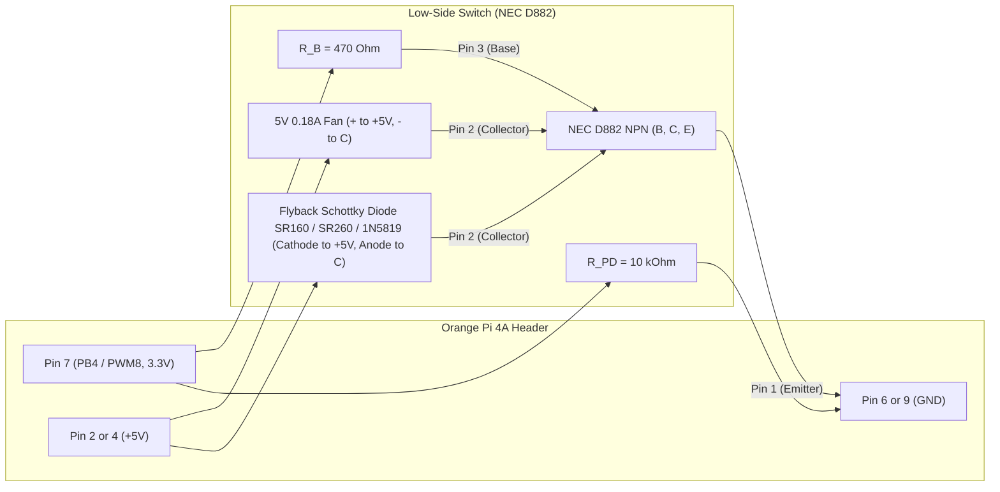
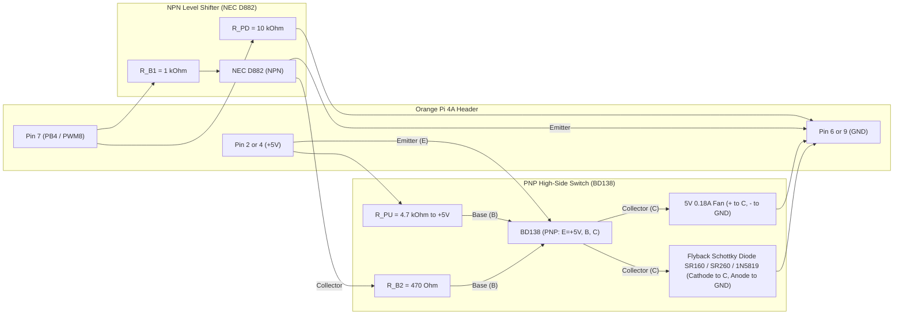

# Hardware Circuit Design — Pin 7 (`PB4` / `PWM8`) + `NEC D882` / `BD138` & 5V 0.18A Fan

This guide covers the electrical design for driving a **5 V, 0.18 A (180 mA)** 2-wire DC cooling fan from Orange Pi 4A **Physical Pin 7 (`PB4` / `PWM8`, 3.3 V logic)** at **20 kHz** ($T = 50\,\mu\text{s}$) using your **`NEC D882`** and/or **`BD138`** transistors.

---

## 1. Component Identification (`NEC D882` vs. `BD138`)

Both parts are **medium-power BJTs** (Bipolar Junction Transistors, `TO-126` package — **Base, Collector, Emitter**, not MOSFETs):

| Part | Type | Polarity | Max $I_C$ | Package Pinout (Flat Face, Pins Down) | Best Role on 3.3 V GPIO + 5 V Fan |
| --- | --- | --- | --- | --- | --- |
| **`NEC D882` (`2SD882`)** | **NPN BJT** | Non-inverting low-side | $3\text{ A}$ | `1: Emitter`, `2: Collector`, `3: Base` | **Recommended single-transistor low-side switch** |
| **`BD138`** | **PNP BJT** | High-side (active-low base) | $-1.5\text{ A}$ | `1: Emitter`, `2: Collector`, `3: Base` | **Cannot connect directly to 3.3 V GPIO on 5 V rail** (needs NPN pre-driver) |

> **Why `BD138` alone will NOT work on a 5 V fan from a 3.3 V GPIO:**  
> With the `BD138` Emitter at $+5\text{ V}$ and its Base driven by a $3.3\text{ V}$ GPIO (`PB4`), when `PB4` is HIGH ($3.3\text{ V}$) the Emitter-Base junction is still forward-biased:
> $$V_{EB} = 5.0\text{ V} - 3.3\text{ V} = 1.7\text{ V} > 0.7\text{ V}$$
> This keeps the `BD138` permanently **ON** (it can never turn off!) and backfeeds $> 4\text{ V}$ into the $3.3\text{ V}$ SoC pin. Use **`NEC D882` alone** (Section 2), or pair **`NEC D882` + `BD138`** if you specifically need high-side switching (Section 3).

> Always confirm `E / C / B` pin order on your exact `TO-126` batch using a multimeter's diode-test mode before soldering.

---

## 2. Recommended Circuit: Single `NEC D882` (NPN Low-Side Switch)

This is the cleanest single-transistor circuit for a $5\text{ V}, 0.18\text{ A}$ fan and matches `POLARITY="normal"` in `/etc/default/opi4a-fan-pwm`.

### Schematic Flowchart

### Base Resistor & Power Calculations

1. **Required Base Current ($I_B$) for Saturation:**
   With fan current $I_C = 0.18\text{ A}$ ($180\text{ mA}$), targeting a conservative forced gain $\beta_{\text{forced}} \approx 30\text{--}35$ ensures deep saturation:
   $$I_B = \frac{I_C}{\beta_{\text{forced}}} = \frac{0.18\text{ A}}{33} \approx 5.45\text{ mA}$$

2. **Base Resistor ($R_B$):**
   With `PB4` high voltage $V_{OH} = 3.3\text{ V}$ and `D882` $V_{BE(\text{sat})} \approx 0.75\text{ V}$:
   $$R_B = \frac{V_{OH} - V_{BE(\text{sat})}}{I_B} = \frac{3.3\text{ V} - 0.75\text{ V}}{0.00545\text{ A}} \approx 468\,\Omega \rightarrow \mathbf{470\,\Omega}$$
   - Current drawn from Pin 7 (`PB4`): $\sim 5.4\text{ mA}$ (safely below the $10\text{ mA}$ `drive-strength` configured in the DTB; $560\,\Omega$ giving $\sim 4.5\text{ mA}$ also works well).
   - Add **$R_{PD} = 10\text{ k}\Omega$** from Pin 7 (or Base) to `GND` so the fan remains firmly OFF while `PB4` is high-impedance during boot, shutdown, or if the jumper wire disconnects (draws only $0.33\text{ mA}$ at $3.3\text{ V}$).

3. **Transistor Dissipation ($P_{Q1}$):**
   At $180\text{ mA}$, $V_{CE(\text{sat})} \approx 0.15\text{ V}$:
   $$P_{Q1} \approx V_{CE(\text{sat})} \cdot I_C = 0.15\text{ V} \times 0.18\text{ A} = 27\text{ mW}$$
   No heatsink is required.

4. **Flyback Diode ($D_F$ — Parallel Across Fan):**
   Place a fast **Schottky diode** in **parallel** across the fan (**Cathode band** to $+5\text{ V}$, **Anode** to `D882` Collector):
   - **`SR160`** ($60\text{ V}, 1\text{ A}$, `DO-41` — best physical fit) or **`SR260`** ($60\text{ V}, 2\text{ A}$, `DO-15`) are drop-in equivalents/upgrades over `1N5819` ($40\text{ V}, 1\text{ A}$).
   - **Why parallel (not series):** During normal ON time, $D_F$ is reverse-biased and draws zero current; the instant `D882` switches OFF at 20 kHz, $V_L = -L\frac{dI}{dt}$ forward-biases $D_F$ so inductive coil current safely recirculates through the fan instead of spiking the Collector above $V_{CEO} = 30\text{ V}$. A series diode cannot clamp the open Collector node.
   - Schottky diodes switch in nanoseconds at 20 kHz, avoiding the reverse-recovery losses of slow `1N4007` rectifiers.

---

## 3. Optional High-Side Circuit: `NEC D882` + `BD138` (Complementary Pair)

Only use this if you specifically want the fan's negative lead tied directly to `GND` (high-side switching on $+5\text{ V}$). This topology also preserves `POLARITY="normal"` (`PB4` HIGH $\rightarrow$ `D882` ON $\rightarrow$ `BD138` Base pulled down $\rightarrow$ `BD138` ON $\rightarrow$ Fan ON).

- **Sizing:**
  - $R_{B1} = 1\text{ k}\Omega$ gives $I_{B1} \approx 2.6\text{ mA}$ on `D882`.
  - $R_{B2} = 470\,\Omega$ limits `BD138` base current to:
    $$I_{B2} \approx \frac{5.0\text{ V} - V_{EB(\text{sat})} - V_{CE(\text{sat},Q1)}}{R_{B2}} = \frac{5.0\text{ V} - 0.75\text{ V} - 0.1\text{ V}}{470\,\Omega} \approx 8.8\text{ mA}$$
    Giving $\beta_{\text{forced}} = 180\text{ mA} / 8.8\text{ mA} \approx 20$, saturating `BD138` cleanly.
  - $R_{PU} = 4.7\text{ k}\Omega$ (connected between `BD138` Emitter $+5\text{ V}$ and Base) ensures clean turn-off when `D882` turns off.

---

## 4. 20 kHz 2-Wire Fan Behavior Note

Both schematics above are **non-inverting**, matching `POLARITY="normal"` in `/etc/default/opi4a-fan-pwm`.

Most 2-wire 5 V fans have an internal brushless controller IC. If your fan struggles to regulate smoothly at 20 kHz (`PERIOD_NS=50000`) when its supply is PWM-chopped, lower the frequency in `/etc/default/opi4a-fan-pwm` (for example `PERIOD_NS=1000000` for 1 kHz or `PERIOD_NS=4000000` for 250 Hz, scaling `KICK_DUTY_NS` and `DUTY_*_NS` proportionally) and run `sudo systemctl restart opi4a-fan-pwm.service`.
